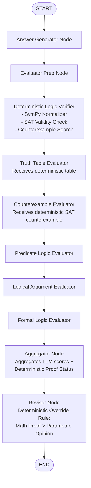

# Sprint 4 — Phase 1: Deterministic Verification Audit Report

**Project**: TalkHier BTP — Multi-Agent Hierarchical Formal Reasoning  
**Phase**: Sprint 4 — Phase 1: Deterministic Verification Audit  
**Target Repository**: `/Users/mohithchandra/BTP/talkhier`  
**Date**: November 5, 2026  
**Status**: READ-ONLY Audit Completed (Awaiting Approval for Implementation)

---

## Executive Summary

Sprint 3 Optimization achieved **80% accuracy** (4/5) and **0% harmful revisions** by using specialized prompt engineering and Revisor heuristics. However, pure LLM reasoning remains vulnerable to edge-case hallucinations and semantic drift. 

This audit inspects the existing deterministic tools (`TruthTableGenerator` and `CounterexampleVerifier`), benchmarks them on five representative propositional logic test cases, analyzes their current execution behavior in the LangGraph multi-agent pipeline, and outlines the precise architectural modifications required to integrate **SymPy-powered deterministic evidence** into Sprint 4.

### Key Audit Findings:
1. **Genuine Deterministic Computation Exists**: Both tools use SymPy (`sympify`, `Not`, `And`, `Or`, `Implies`, `Equivalent`) and perform real boolean evaluations rather than LLM simulation.
2. **Critical Behavioral Flaw in `TruthTableGenerator`**: The existing tool evaluates whether all input formulas are **mutually equivalent** (`Equivalent(*exprs)`). It **does not** evaluate deductive argument validity ($\bigwedge \text{Premises} \models \text{Conclusion}$).
3. **MMLU Syntax Crash**: Both tools crash immediately on standard logic Unicode symbols used across MMLU Formal Logic (`⊃`, `•`, `∨`, `→`, `¬`), because `sympify` expects Python/SymPy syntax (`>>`, `&`, `|`, `~`).
4. **Tool-Call Short-Circuiting in React Nodes**: In Sprint 3 traces, evaluators **never actually invoked** `truthtable_generator` or `counterexample_verifier`. Because evaluator prompts requested immediate JSON in `intermediate_output`, the LLM skipped tool calling and answered parametrically in one shot.
5. **SymPy 1.13.1 SAT Capabilities**: SymPy's `satisfiable` function (`sympy.logic.inference.satisfiable`) can deterministically prove argument validity and automatically extract genuine counterexamples in under 1 millisecond.

---

## 1. Existing Tool Implementations

Both tools are defined in [`src/multiagent/tools.py`](file:///Users/mohithchandra/BTP/talkhier/src/multiagent/tools.py):

### 1.1 `TruthTableGenerator`
- **Location**: [`src/multiagent/tools.py#L140-L216`](file:///Users/mohithchandra/BTP/talkhier/src/multiagent/tools.py#L140-L216)
- **Class Signature**: `class TruthTableGenerator(BaseTool)`
- **Tool Name**: `truthtable_generator`
- **Schema**: `args_schema = SerpAPIInput` (takes a single string `in_str: str`)
- **Dependencies**: `sympy` (`sympify`, `symbols`, `Not`, `Or`, `And`, `Implies`, `Equivalent`), `itertools`, `ast`.
- **Implementation Mechanics**:
  - Parses `in_str` via `ast.literal_eval(in_str)`.
  - Sets up `local_dict` mapping `~` $\to$ `Not`, `&` $\to$ `And`, `|` $\to$ `Or`, `>>` $\to$ `Implies`, `EQ` $\to$ `Equivalent`.
  - If more than 1 expression is provided, it appends `Equivalent(*parsed_expressions)` and checks if all formulas share the exact same truth values.
  - Generates full truth assignments using `itertools.product([False, True], repeat=len(variables))`.
  - Returns a formatted ASCII truth table.

### 1.2 `CounterexampleVerifier`
- **Location**: [`src/multiagent/tools.py#L219-L287`](file:///Users/mohithchandra/BTP/talkhier/src/multiagent/tools.py#L219-L287)
- **Class Signature**: `class CounterexampleVerifier(BaseTool)`
- **Tool Name**: `counterexample_verifier`
- **Schema**: `args_schema = SerpAPIInput` (`in_str: str`)
- **Dependencies**: `sympy` (`sympify`, `symbols`, `Not`, `Or`, `And`, `Implies`, `Equivalent`), `ast`.
- **Implementation Mechanics**:
  - Parses a stringified dictionary: `{"premises": [...], "conclusion": ..., "truth_values": [{var: "True/False"}]}`.
  - Converts string booleans (`"True"`, `"T"`, `"true"`) to Python `True`/`False`.
  - Evaluates premises and conclusion using SymPy's `expr.subs(var_dict)`.
  - Verifies counterexample definition: `if all(premises_truths) and not conclusion_truth: Valid counterexample` else `Not a counterexample`.

---

## 2. Tool Execution Behaviour in Current Codebase

### 2.1 Agent Tool Access Permissions
In [`src/prompts/mmlu.py#L95`](file:///Users/mohithchandra/BTP/talkhier/src/prompts/mmlu.py#L95) and [`#L212`](file:///Users/mohithchandra/BTP/talkhier/src/prompts/mmlu.py#L212):
- **Truth Table Evaluator**: Assigned tools `[4, 8]` (`OutputTool`, `TruthTableGenerator`).
- **Counterexample Evaluator**: Assigned tools `[4, 9]` (`OutputTool`, `CounterexampleVerifier`).
- **Predicate Logic Evaluator**: Assigned tool `[4]` (`OutputTool`).
- **Logical Argument Evaluator**: Assigned tool `[4]` (`OutputTool`).
- **Formal Logic Evaluator**: Assigned tool `[4]` (`OutputTool`).
- **Revisor**: Assigned tools `[4, 8, 9]` (`OutputTool`, `TruthTableGenerator`, `CounterexampleVerifier`).
- **Answer Generator**: Assigned tool `[4]` (`OutputTool`).

### 2.2 Why Evaluators Did Not Invoke Tools in Sprint 3
An inspection of traces in [`results/experiment_d_graph/`](file:///Users/mohithchandra/BTP/talkhier/results/experiment_d_graph/) and [`results/experiment_d_graph_opt/`](file:///Users/mohithchandra/BTP/talkhier/results/experiment_d_graph_opt/) reveals **0 tool calls** across all 5 problems:
1. **Prompt Structure vs Tool-Calling Friction**: The evaluator prompt instructs: *"Output strictly in intermediate_output: {\"evaluation\": ...}"*. Qwen3:8B recognizes this as a direct completion task and immediately outputs the JSON without emitting a tool call.
2. **Schema Ambiguity**: Both tools use `SerpAPIInput` (`in_str: str = Field(description="input to tool")`), providing zero structured parameter hints to the LLM.
3. **Syntax Barrier**: MMLU problems use `⊃`, `•`, `∨`, `~`. An LLM would have to translate these to SymPy function calls in a single string, construct an escaped Python dictionary string, invoke the tool, wait for the response, and then formulate its JSON evaluation. The model consistently takes the path of least resistance (parametric generation).

---

## 3. Empirical Test Results on Required Test Cases

We executed both tools against the five required propositional logic test cases in the local Python 3.12 environment with SymPy 1.13.1:

```
========================================================================================================================
Test Case                               | Input Formula / Argument                      | Tool Tested              | Result / Output Status
----------------------------------------|-----------------------------------------------|--------------------------|-----------------------------------------
1. Valid Argument (Modus Ponens)        | Prem: A >> B, A | Concl: B                    | TruthTableGenerator      | Generated table, but labeled as
                                        |                                               |                          | non-equivalent across formulas.
                                        |                                               | CounterexampleVerifier   | "Not a counterexample" across all 4 rows.
----------------------------------------|-----------------------------------------------|--------------------------|-----------------------------------------
2. Invalid Argument w/ Counterexample   | Prem: A >> B, B | Concl: A                    | CounterexampleVerifier   | PASS: Identified {A: False, B: True}
   (Affirming the Consequent)           | Candidate: {A: False, B: True}                |                          | as "Valid counterexample".
----------------------------------------|-----------------------------------------------|--------------------------|-----------------------------------------
3. False Counterexample (Problem 3)     | Prem: ~G >> H, ~H | Concl: G                  | CounterexampleVerifier   | PASS: Correctly identified that
   (Conclusion is explicitly TRUE)      | Candidate: {G: True, H: False}                |                          | {G: True, H: False} is "Not a counterexample".
----------------------------------------|-----------------------------------------------|--------------------------|-----------------------------------------
4. Negation and Implication             | SymPy syntax: Implies(Not(A), B)              | TruthTableGenerator      | PASS: Generated exact 4-row truth table.
                                        | Infix syntax: ~A >> B                         | TruthTableGenerator      | PASS: Generated exact 4-row truth table.
                                        | MMLU Unicode syntax: ~A ⊃ B                   | TruthTableGenerator      | FAIL: SyntaxError (cannot parse '⊃').
----------------------------------------|-----------------------------------------------|--------------------------|-----------------------------------------
5. Conjunction and Disjunction          | SymPy syntax: And(A, Or(B, C))                | TruthTableGenerator      | PASS: Generated exact 8-row truth table.
                                        | Infix syntax: A & (B | C)                     | TruthTableGenerator      | PASS: Generated exact 8-row truth table.
                                        | MMLU Unicode syntax: A • (B ∨ C)              | TruthTableGenerator      | FAIL: SyntaxError (cannot parse '•').
                                        | Disjunctive Syllogism in CounterexampleVerifier| CounterexampleVerifier  | PASS: Confirmed no counterexample exists.
========================================================================================================================
```

### Detailed Test Trace Highlights:

#### Test 3: Problem 3 Counterexample Verification
```python
inp = {
    'premises': ['Implies(Not(G), H)', 'Not(H)'],
    'conclusion': 'G',
    'truth_values': [{'G': 'True', 'H': 'False'}]
}
# Output:
# For {'G': True, 'H': False}: Not a counterexample.
# The given truth values do not satisfy the conditions for a counterexample.
```
*Finding*: The tool's deterministic logic correctly catches the Problem 3 fallacy.

#### Test 4 & 5: Unicode Parsing Failure
```python
tt._run("['~A ⊃ B']")
# Error processing expressions: Sympify of expression 'could not parse '~A ⊃ B'' failed,
# because of exception being raised: SyntaxError: invalid syntax (<string>, line 1)
```
*Finding*: MMLU logical connectives require automated pre-normalization before SymPy parsing.

---

## 4. Missing Capabilities & Technical Gaps

1. **Deductive Validity Verification**:
   - `TruthTableGenerator` tests for **equivalence** between expressions, NOT deductive entailment ($\Gamma \models \phi$).
   - *Fix needed*: Implement genuine validity verification: $\Gamma \models \phi \iff (\bigwedge \Gamma \wedge \neg \phi)$ is unsatisfiable.
2. **Automated Counterexample Discovery**:
   - `CounterexampleVerifier` only checks candidate assignments supplied by the user. If an argument is invalid, it cannot search for a counterexample on its own.
   - *Fix needed*: Use SymPy's `satisfiable(And(*premises, Not(conclusion)))`. If satisfiable, the solution returned by SymPy *is* the exact counterexample.
3. **MMLU Logic Formula Normalization**:
   - The tools cannot parse standard textbook and MMLU logical symbols (`⊃`, `•`, `∨`, `~`, `¬`, `→`, `∧`, `↔`, `≡`).
   - *Fix needed*: A regex/string normalizer converting all Unicode logic operators into SymPy equivalents (`>>`, `&`, `|`, `~`).
4. **Structured Output vs Raw Printing**:
   - Both tools use `print(...)` statements that clutter terminal output and return unstructured multi-line text strings.
   - *Fix needed*: Tools should return structured Python dicts with machine-readable boolean flags (`is_valid: bool`, `has_counterexample: bool`, `counterexample: dict`, `truth_table_rows: list`).

---

## 5. Proposed Sprint 4 Architecture

### 5.1 Design Principle: Deterministic Evidence-Guided Pipeline
Rather than relying on the LLM to decide whether to call tools (which failed in Sprint 3), Sprint 4 should compute deterministic logical evidence **at the graph level** and inject it as verified mathematical evidence into the pipeline:



### 5.2 Smallest Changes Required to Integrate into LangGraph

The changes preserve the exact LangGraph topology and require zero new agent types:

1. **Deterministic Logic Engine (`src/multiagent/logic_verifier.py`)**:
   - A clean, standalone module providing:
     - `normalize_logical_formula(expr: str) -> str`: Normalizes `~`, `⊃`, `•`, `∨` to SymPy syntax.
     - `verify_argument_validity(premises: List[str], conclusion: str) -> Dict[str, Any]`:
       - Computes SAT on $\bigwedge \text{Premises} \wedge \neg \text{Conclusion}$.
       - Returns: `{"is_valid": bool, "counterexample": Optional[dict], "truth_table": str}`.
     - `verify_counterexample_candidate(premises, conclusion, candidate_assignment) -> bool`.
2. **Evaluator Prep Node Enhancement**:
   - If the problem involves propositional logic (e.g. premises/conclusion or truth table/counterexample choices), the engine parses the problem and choices, computes the deterministic truth table and SAT proof, and stores it in `state["_deterministic_evidence"]`.
3. **Evaluator Context Injection**:
   - `Truth Table` evaluator receives the precomputed deterministic truth table in its prompt context.
   - `Counterexample` evaluator receives the deterministic counterexample status (valid counterexample exists / no counterexample exists).
4. **Aggregator & Revisor Node Integration**:
   - The Aggregator includes `state["_deterministic_evidence"]` in the structured summary.
   - The Revisor prompt receives a new section:
     ```markdown
     ### Deterministic Formal Verification (SymPy Engine):
     - Mathematical Validity: VALID / INVALID / N/A
     - Proven Counterexample: {G: False, H: True} / NONE (Deductively Sound)
     - Counterexample Candidate Check: Choice 2 assignment {G: True} has Conclusion=True (IMPOSSIBLE COUNTEREXAMPLE)
     ```
   - **Deterministic Override Rule**: If the deterministic engine proves an argument is Valid, the Revisor is strictly forbidden from selecting an "Invalid" choice.

---

## 6. Potential Risks and Limitations

1. **Scope of SymPy Boolean Engine**:
   - SymPy excels at **propositional logic** (Problems 2, 3, 4).
   - It does **not** evaluate natural language philosophical arguments (Problem 0 conclusion identification) or first-order predicate relational order (Problem 1: $Tdc$ vs $Tcd$).
   - *Mitigation*: The deterministic engine will return `status: "NOT_APPLICABLE"` for pure NL or predicate logic problems, allowing the specialized LLM evaluators to handle them exactly as they successfully did in Sprint 3.
2. **Formula Extraction Ambiguity**:
   - If an MMLU problem describes an argument in prose rather than formal symbols, parsing premises and conclusion requires extraction.
   - *Mitigation*: Fall back gracefully to LLM evaluator reasoning if parsing fails, ensuring the system never crashes.
3. **Deterministic Immutability**:
   - The deterministic engine must run deterministically with zero temperature and zero stochasticity. SymPy's SAT solver is 100% reproducible.

---

## 7. Recommendation for Sprint 4 Implementation

1. **Step 1 (Engine Development)**: Create `src/multiagent/logic_verifier.py` implementing robust Unicode formula normalization, SymPy SAT argument validity, and counterexample extraction with complete unit test coverage.
2. **Step 2 (Tool Modernization)**: Update `TruthTableGenerator` and `CounterexampleVerifier` in `src/multiagent/tools.py` to use the normalizer and SAT engine.
3. **Step 3 (Graph Integration)**: Create `src/multiagent/graph_dispatch_sprint4.py` embedding `_deterministic_evidence` into `Evaluator Prep`, `Aggregator`, and `Revisor`.
4. **Step 4 (Validation & Benchmark)**: Validate on Problem 0, run regression tests, and then benchmark on Problems 0–4 against Sprint 3 Optimized.

---

*This report is submitted for user review. No implementation code or prompts have been altered.*
