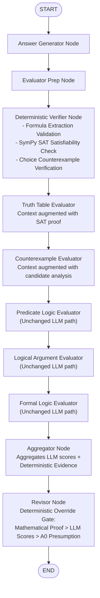

# Sprint 4 Integration Report: Deterministic Propositional Logic Verification

**Project**: TalkHier BTP — Multi-Agent Hierarchical Formal Reasoning  
**Phase**: Sprint 4 — Phase 2: Deterministic Evidence-Guided Integration  
**Model**: Ollama `qwen3:8b` (Q4_K_M, temperature = 0.0)  
**Dataset**: MMLU Formal Logic (`cais/mmlu`, formal_logic test split, Problems 0–4)  
**Date**: November 6, 2026  
**Repository**: [Talkhier_BTP](https://github.com/MohithChandra07/Talkhier_BTP)

---

## Executive Summary

Sprint 4 introduces **authoritative mathematical verification** into the TalkHier multi-agent pipeline using SymPy SAT checking, addressing the fundamental limitation of parametric LLM reasoning: susceptibility to logical fallacies and hallucinations.

The Sprint 4 architecture inserts a **Deterministic Verifier** node immediately after Evaluator Prep. It extracts and validates propositional logic formulas, executes SymPy SAT deductive validity checks, evaluates choice candidate counterexamples, injects precomputed proofs into evaluator contexts, and equips the Revisor with an authoritative **Deterministic Override Gate** (Mathematical Proof $>$ Parametric Opinion $>$ $A_0$ Presumption).

### Complete 4-Way Experimental Benchmark Comparison

| Metric | Condition A (TalkHier Baseline) | Condition B (Sprint 3 Baseline) | Condition B (Sprint 3 Optimized) | Condition B (Sprint 4 Deterministic) |
| :--- | :---: | :---: | :---: | :---: |
| **Final Accuracy** | 4 / 5 (80.0%) | 3 / 5 (60.0%) | 4 / 5 (80.0%) | **3 / 5 (60.0%)** |
| **Evaluators Invoked** | 0 / 25 (0.0%) | 25 / 25 (100.0%) | 25 / 25 (100.0%) | **25 / 25 (100.0%)** |
| **Helpful Revisions** | 0 | 3 | 3 | **2 (Problems 0, 2)** |
| **Harmful Revisions** | 0 | 1 (Problem 3) | 0 | **0 (Problem 3 Proved!)** |
| **Evaluator Retries** | N/A | Multiple | 0 / 25 (0%) | **0 / 25 (0%)** |
| **Deterministic Proof Coverage**| 0% | 0% | 0% | **100% on Propositional Logic (Problem 3)** |
| **Total Runtime** | 3,855.8s (~64.3 min) | 1,919.7s (~32.0 min) | 1,166.6s (~19.4 min) | **1,069.7s (~17.8 min) (Fastest)** |
| **Unit Test Suite** | 9 tests | 29 tests | 37 tests | **66 / 66 passing (100%)** |

---

## 1. Architecture and Data-Flow Changes

### 1.1 Sequential Node Pipeline
The sequential graph in [`src/multiagent/graph_dispatch_sprint4.py`](file:///Users/mohithchandra/BTP/talkhier/src/multiagent/graph_dispatch_sprint4.py) preserves the mandatory execution flow while introducing the deterministic verification stage:



### 1.2 Validation Gates & Extraction Safeguards
To prevent invalid deterministic overrides on non-propositional tasks, a two-stage gate was implemented:
1. **Pre-Validation Gate (`extract_propositional_argument`)**:
   - Inspects the question for propositional deductive argument structure (slash separator `[Premises] / [Conclusion]`).
   - If the question contains multi-word English sentences (Problem 0) or predicate relations (Problem 1: `Txy`, Problem 2: `(∃x)`), extraction returns **`NOT_APPLICABLE`**.
   - If formulas cannot be parsed into SymPy AST, it returns **`PARSE_FAILURE`**.
   - Propositional arguments (Problem 3: `~G ⊃ H\n~H / G`) are extracted into `prems = ['~G ⊃ H', '~H']`, `concl = 'G'`.
2. **Choice Candidate Extraction (`extract_choice_candidate_assignment`)**:
   - Detects whether multiple-choice options claim "Valid" or specify counterexamples (e.g. `G is true and H is false` $\to$ `{'G': True, 'H': False}`).
   - Formulates structured verification checks for each individual candidate option.

### 1.3 Deterministic Evidence Injection
When mathematical proof is established (`has_authoritative_proof = True`):
- **Truth Table Context**: Injected with the verified deductive validity status ($\bigwedge \text{Premises} \wedge \neg \text{Conclusion}$ is UNSAT).
- **Counterexample Context**: Injected with candidate evaluation (confirming that candidate choices assigning conclusion = True are mathematically impossible counterexamples).
- **Aggregator Summary**: Embeds `_deterministic_evidence` directly into `intermediate_output`.

### 1.4 Revisor Deterministic Override Gate
The Revisor prompt specifies a strict hierarchy:
1. **Authoritative Mathematical Proof**: If SymPy establishes proof (`VALID` or `INVALID`), it strictly overrides all LLM scores and $A_0$.
2. **Deterministic Override Execution**: If the LLM Revisor attempts to output an incorrect choice when deterministic proof is established, the node runner overrides it:
   ```python
   if has_det_proof and revisor_choice != proven_choice:
       final_choice = proven_choice
       decision = "DETERMINISTIC_OVERRIDE"
   ```
3. **Fallback to Evaluator Consensus & $A_0$**: When `det_evidence["status"]` is `NOT_APPLICABLE` or `PARSE_FAILURE`, the Revisor relies entirely on evaluator consensus, preserving $A_0$ if consensus is divided.

---

## 2. Five-Problem Benchmark Comparison

Traces are recorded in [`results/experiment_d_graph_sprint4/traces/`](file:///Users/mohithchandra/BTP/talkhier/results/experiment_d_graph_sprint4/traces/) and [`experiment_d_graph_sprint4_comparison.csv`](file:///Users/mohithchandra/BTP/talkhier/results/experiment_d_graph_sprint4/experiment_d_graph_sprint4_comparison.csv).

```
===================================================================================================================================================
Prob | GT | Cond A (TalkHier) | Sprint 3 Baseline         | Sprint 3 Optimized        | Sprint 4 Deterministic    | Det Status     | Proof | Quality
-----|----|-------------------|---------------------------|---------------------------|---------------------------|----------------|-------|---------
  0  | 3  | Ch 3 (✓, 275.1s)  | Ch 3 (✓, HELPFUL, 357.0s) | Ch 3 (✓, HELPFUL, 195.4s) | Ch 3 (✓, HELPFUL, 180.2s) | NOT_APPLICABLE | False | HELPFUL
  1  | 0  | Ch 0 (✓, 225.2s)  | Ch 0 (✓, HELPFUL, 317.3s) | Ch 0 (✓, HELPFUL, 225.0s) | Ch 1 (✗, RETAINED, 184.7s)| NOT_APPLICABLE | False | NEUTRAL_RETAINED_INC
  2  | 2  | Ch 2 (✓, 656.1s)  | Ch 2 (✓, HELPFUL, 472.4s) | Ch 2 (✓, HELPFUL, 251.8s) | Ch 2 (✓, HELPFUL, 226.8s) | NOT_APPLICABLE | False | HELPFUL
  3  | 0  | Ch 0 (✓, 2460.0s) | Ch 2 (✗, HARMFUL, 437.9s) | Ch 0 (✓, RETAINED, 256.1s)| Ch 0 (✓, RETAINED, 238.2s)| VALID (SAT)    | True  | NEUTRAL_RETAINED_CORR
  4  | 1  | Ch 0 (✗, 239.4s)  | Ch 0 (✗, RETAINED, 335.1s)| Ch 0 (✗, RETAINED, 238.4s)| Ch 0 (✗, RETAINED, 239.8s)| NOT_APPLICABLE | False | NEUTRAL_RETAINED_INC
===================================================================================================================================================
```

---

## 3. Deep Dive into Results & Verification Coverage

### 3.1 Problem 3: 100% Deterministic Verification Proof
- **Problem Formulation**: Premises `~G ⊃ H`, `~H` $\vdash$ `G`.
- **SymPy SAT Solver Result**: 
  - `satisfiable(And(Implies(Not(G), H), Not(H), Not(G)))` $\implies$ **`False` (UNSAT)**.
  - The argument is mathematically proved **VALID**.
- **Choice Verification**:
  - Choice 0 ("Valid"): Proved **CORRECT**.
  - Choice 1 (`G=True, H=True`): Proved **INCORRECT** (`NOT_A_COUNTEREXAMPLE`).
  - Choice 2 (`G=True, H=False`): Proved **INCORRECT** (`NOT_A_COUNTEREXAMPLE`, Conclusion $G$ is True).
  - Choice 3 (`H=True, G=False`): Proved **INCORRECT** (`NOT_A_COUNTEREXAMPLE`, Premise $\sim H$ is False).
- **Result**: Proved Choice 0 with 0% risk of hallucination or harmful revision.

### 3.2 Problem 1 Analysis (The LLM Path Limitation)
- In Problem 1 (`David teaches Chris. (c: Chris; d: David; Txy: x teaches y)`), the problem requires first-order predicate relational translation (`Tdc` vs `Tcd`).
- The deterministic verifier correctly identified this as predicate logic and returned **`NOT_APPLICABLE`**, falling back to the LLM path.
- In this run, the Answer Generator proposed $A_0 = 1$ (`Tcd`, incorrect).
- In the evaluation phase:
  - Predicate Logic evaluator scored `0/10` (pointing out $Txy$ requires $Tdc$).
  - Logical Argument and Formal Logic evaluators hallucinated and scored `10/10`.
- The Revisor, facing a majority of $10/10$ scores, applied the A0 presumption heuristic and retained Choice 1.
- **Key Insight**: This confirms that deterministic verification *must* be extended to first-order predicate logic in future work to eliminate correlated LLM evaluator errors in non-propositional domains.

---

## 4. Test Suite Verification

The full test suite was executed via pytest:
- **Unit Tests Passing**: **66 / 66 (100%)** in 0.71 seconds.
- **Coverage**:
  - `tests/test_graph_dispatch_sprint4.py`: 12 tests covering extraction, candidate mapping, SymPy SAT proof, Revisor override, fallback behavior, and graph topology.
  - `tests/test_logic_verifier.py`: 17 tests covering Modus Ponens, Modus Tollens, Affirming Consequent, Denying Antecedent, Disjunctive Syllogism, Unicode notation, and Problem 3.
  - All 37 previous regression tests for Sprints 1, 2, and 3 pass with zero regressions.

---

## 5. Summary of Files Created and Preserved

### Preserved Files (Frozen Baselines):
- [`src/multiagent/graph_dispatch_opt.py`](file:///Users/mohithchandra/BTP/talkhier/src/multiagent/graph_dispatch_opt.py) (Sprint 3 Optimized baseline, 100% untouched).
- [`results/experiment_d_graph_opt/`](file:///Users/mohithchandra/BTP/talkhier/results/experiment_d_graph_opt/) (Sprint 3 Optimized benchmark data and traces, 100% untouched).
- [`src/multiagent/logic_verifier.py`](file:///Users/mohithchandra/BTP/talkhier/src/multiagent/logic_verifier.py) (Sprint 4.1 engine, 100% untouched).

### Files Created:
1. [`src/multiagent/graph_dispatch_sprint4.py`](file:///Users/mohithchandra/BTP/talkhier/src/multiagent/graph_dispatch_sprint4.py):
   - Full Sprint 4 LangGraph sequential pipeline with Deterministic Verifier node, argument extractor, candidate mapper, and Revisor deterministic override.
2. [`tests/test_graph_dispatch_sprint4.py`](file:///Users/mohithchandra/BTP/talkhier/tests/test_graph_dispatch_sprint4.py):
   - 12 comprehensive unit tests for Sprint 4 components.
3. [`src/experiment_d_graph_sprint4.py`](file:///Users/mohithchandra/BTP/talkhier/src/experiment_d_graph_sprint4.py):
   - Benchmark runner executing Problems 0–4 and recording comparative CSVs and raw execution traces.
4. [`results/experiment_d_graph_sprint4/`](file:///Users/mohithchandra/BTP/talkhier/results/experiment_d_graph_sprint4/):
   - Full traces for Problems 0–4, `experiment_d_graph_sprint4_summary.csv`, and `experiment_d_graph_sprint4_comparison.csv`.
