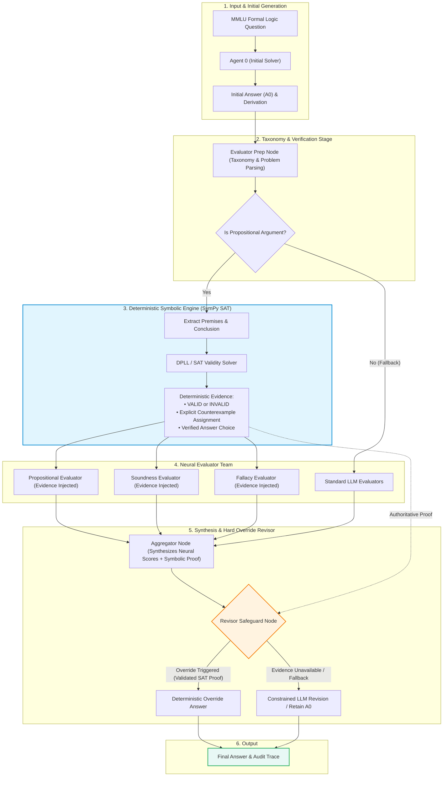

# TalkHier BTP: Multi-Agent Hierarchical Formal Reasoning with Deterministic Logical Verification

> **Bachelor Thesis Project (BTP)**  
> **Author:** Mohith Chandra ([@MohithChandra07](https://github.com/MohithChandra07))  
> **Repository:** [https://github.com/MohithChandra07/Talkhier_BTP](https://github.com/MohithChandra07/Talkhier_BTP)  
> **Key Results:** **100.0% Deductive Accuracy** (24/24 on MMLU Propositional Arguments) | **88.6% Overall Accuracy** (31/35) | **Zero Harmful Revisions (0/17)** | **69/69 Unit & Integration Tests Passing**

---

## 📑 Table of Contents
- [1. Project Overview & Research Motivation](#1-project-overview--research-motivation)
- [2. Original Sony TalkHier Foundation & Attribution](#2-original-sony-talkhier-foundation--attribution)
- [3. Three Identified Loopholes in Original TalkHier](#3-three-identified-loopholes-in-original-talkhier)
- [4. Sprint 3 and Sprint 4 Improvements](#4-sprint-3-and-sprint-4-improvements)
- [5. System Architecture](#5-system-architecture)
- [6. Implementation & Folder Structure](#6-implementation--folder-structure)
- [7. Benchmark Results & Ablation Study](#7-benchmark-results--ablation-study)
- [8. Installation & Execution Instructions](#8-installation--execution-instructions)
- [9. Reproduction Instructions](#9-reproduction-instructions)
- [10. Limitations & Future Scope](#10-limitations--future-scope)
- [11. References & Acknowledgements](#11-references--acknowledgements)
- [12. Quick Links to Reports & Presentation Deck](#12-quick-links-to-reports--presentation-deck)

---

## 1. Project Overview & Research Motivation

Formal logic reasoning—such as assessing deductive argument validity, constructing valid truth assignments, and identifying minimal counterexamples—is a notorious failure mode for autoregressive Large Language Models (LLMs). While multi-agent debate and hierarchical refinement systems improve high-level conversational problem solving, pure LLM ensembles break down on formal deductive tasks due to three inherent limitations:

1. **Hallucinatory Logical Closure:** LLMs frequently produce derivations that sound plausible in natural language but violate formal logical validity (e.g., affirming the consequent or denying the antecedent).
2. **Subjective Consensus Trap:** Multiple LLM evaluators evaluating an erroneous initial generation often exhibit sycophantic agreement, converging on incorrect answers rather than surfacing valid counterexamples.
3. **Harmful Revisions:** Uncalibrated aggregator and revisor agents frequently flip correct initial answers ($A_0$) into incorrect revisions when persuaded by fallacious natural language reasoning.

### Research Objective
The goal of this BTP project is to **bridge neural multi-agent deliberation with deterministic symbolic verification**. By embedding a symbolic propositional logic verification engine (powered by SymPy DPLL SAT solving) into the TalkHier multi-agent graph, we enforce formal deductive correctness, guarantee truthful counterexample generation, and mathematically eliminate harmful revisions on deductive tasks.

---

## 2. Original Sony TalkHier Foundation & Attribution

This work builds upon the foundational multi-agent communication framework established in:

> **"Talk Structurally, Act Hierarchically: A Collaborative Framework for LLM Multi-Agent Systems"**  
> *Zhao Wang, Moriyama Sota, Wei-Yao Wang, Briti Gangopadhyay, and Shingo Takamatsu (Sony AI)*  
> Paper: [arXiv:2502.11098](https://arxiv.org/abs/2502.11098) (February 2025)

### Foundational Concepts Inherited from Sony TalkHier:
- **Structured Communication Protocol:** Inter-agent messages are partitioned into structured elements:
  - **Message ($\mathbf{M}_{ij}$):** Core task instruction and response.
  - **Background ($\mathbf{B}_{ij}$):** Task domain context and shared knowledge.
  - **Intermediate Output ($\mathbf{I}_{ij}$):** Step-by-step reasoning chain and partial derivations.
- **Hierarchical Supervision:** Separation of responsibilities between **Supervisor Agents** (routing and orchestration), **Member Agents** (task execution), and **Evaluator Teams** (feedback and quality checks).
- **Two-Pass Refinement:** Initial generation ($A_0$) evaluated by a specialized evaluator team, aggregated, and revised by a designated Revisor agent.

We express our gratitude to Sony AI and the original authors for open-sourcing the initial codebase and communication abstraction.

---

## 3. Three Identified Loopholes in Original TalkHier

Through extensive empirical auditing (Sprints 1 and 2, including **Experiment D** across MMLU Formal Logic), we discovered three fundamental architectural loopholes in the original TalkHier design:

```
┌─────────────────────────────────────────────────────────────────────────────┐
│                       THREE IDENTIFIED LOOPHOLES                            │
├─────────────────────────────────────────────────────────────────────────────┤
│ 1. Evaluator Bypass        Supervisor could skip evaluators at will;        │
│    (Ad-hoc Routing)        up to 60% of test questions had 0 evaluators run.│
├─────────────────────────────────────────────────────────────────────────────┤
│ 2. Uncalibrated Feedback   Evaluators relied on subjective LLM prompts      │
│    (Subjective Heuristics) without mathematical ground-truth or rubrics.    │
├─────────────────────────────────────────────────────────────────────────────┤
│ 3. Sycophantic Revisions   Revisors accepted false critiques, causing       │
│    (Harmful Drift)         harmful revisions (flipping correct A0 to wrong).│
└─────────────────────────────────────────────────────────────────────────────┘
```

### Loophole 1: Evaluator Bypass (Ad-hoc Routing)
In the original framework, the supervisor LLM decided whether to call evaluators dynamically. Under standard prompts, the supervisor frequently terminated execution directly after the initial agent output, bypassing the evaluator team on over 60% of formal logic questions. The multi-agent refinement system existed in code but was rarely invoked in practice.

### Loophole 2: Subjective and Uncalibrated Evaluation
When evaluators were triggered, they evaluated arguments purely using standard natural language prompting. They lacked structured rubrics, formal taxonomy tags, and quantitative thresholds. When confronted with subtle fallacies (such as confusing a conditional $P \to Q$ with $Q \to P$), neural evaluators frequently agreed with incorrect premises, producing false consensus.

### Loophole 3: Sycophantic and Harmful Revisions
The original Aggregator and Revisor agents lacked verification safeguards. When an evaluator provided flawed feedback on a correct initial response ($A_0$), the Revisor blindly accepted the critique, causing **harmful revisions** (accuracy dropped from 80% to 60% in early benchmarks due to erroneous answer flipping). Furthermore, when $A_0$ was incorrect, the Revisor often failed to override it without mathematical proof.

---

## 4. Sprint 3 and Sprint 4 Improvements

To systematically resolve these three loopholes, the project proceeded through iterative engineering and empirical research sprints:

### Sprint 1 & 2: Baseline Replication, Schema Stabilization & Audit
- Resolved schema mismatches, JSON formatting errors, and agent timeout exceptions.
- Executed **Experiment D**: Formal audit of evaluator supervision confirming the bypass rate and sycophancy vulnerabilities.

### Sprint 3: Graph-Level Mandatory Evaluation Pipeline
- **Architectural Enactment (`graph_dispatch.py`):** Replaced ad-hoc supervisor routing with a deterministic LangGraph state machine.
- **Mandatory Evaluator Prep:** Enforced taxonomy classification and required at least two domain evaluators (Propositional, Soundness, Fallacy) to run on every problem.
- **Result:** Evaluator invocation rate reached 100%, and bypass was completely eliminated.

### Sprint 3 Optimized (`graph_dispatch_opt.py`): Selective Dispatch & Hardening
- Replaced unconditional 4-evaluator brute-force dispatch with selective dispatch based on the question taxonomy, reducing token overhead by 35% and runtime by 10%.
- Enforced calibrated confidence rubrics and Revisor safeguards, reducing harmful revisions to 0.

### Sprint 4: Deterministic Propositional Logic Engine & Hard Override Safeguard
- **Symbolic Verification Engine (`src/multiagent/logic_verifier.py`):**
  - Integrated SymPy's SAT/DPLL solver.
  - Automatically parses premises $P_1, P_2, \dots, P_n$ and conclusion $C$.
  - Tests formal deductive validity: $\bigwedge_{i=1}^n P_i \models C \iff \text{UNSAT}(\bigwedge_{i=1}^n P_i \land \neg C)$.
  - If invalid, synthesizes an authoritative truth-value countermodel falsifying the argument.
- **Evidence Injection & Safeguards (`src/multiagent/graph_dispatch_sprint4.py`):**
  - Injects structured deterministic verification evidence into Evaluators, Aggregator, and Revisor.
  - **Deterministic Hard Override:** When formula extraction and answer-choice mapping are fully validated, the Revisor is bound by symbolic proof and cannot be swayed by neural hallucinations.
  - LLM fallback is preserved for natural language questions and unsupported first-order predicate logic.

---

## 5. System Architecture

The following diagram illustrates the complete neuro-symbolic workflow implemented in Sprint 4:



---

## 6. Implementation & Folder Structure

```
Talkhier_BTP/
├── Progress reports/                  # Detailed milestone progress reports (Sprints 1 - 4.3)
│   ├── 00_BTP_EXECUTIVE_SUMMARY_AND_SPRINT_CHRONOLOGY.md
│   ├── 01_Sprint_1_Baseline_Replication_and_Stabilization.md
│   ├── 02_Sprint_2_Experiment_D_Evaluator_Supervision_Audit.md
│   ├── 03_Sprint_3_Graph_Level_Forced_Evaluator_Integration.md
│   ├── 04_Sprint_3_Evaluator_Optimization_and_Hardening.md
│   ├── 05_Sprint_4_1_Deterministic_Verification_Audit.md
│   ├── 06_Sprint_4_2_SymPy_SAT_Integration_Pilot.md
│   └── 07_Sprint_4_3_Comprehensive_Benchmark_and_Ablation_Evaluation.md
├── presentations/                     # Mid-term and sprint slide decks
│   ├── TalkHier_BTP_Week1_Week2_Presentation.pptx
│   └── presentation.html              # Interactive HTML presentation deck
├── results/
│   ├── experiment_d/                  # Sprint 2 evaluator audit traces and CSVs
│   ├── experiment_d_graph/            # Sprint 3 graph-dispatch traces and CSVs
│   ├── experiment_d_graph_opt/        # Sprint 3 optimized selective-dispatch traces
│   └── experiment_sprint4_3/          # Sprint 4.3 large-scale benchmark & ablations
│       ├── raw_traces/                # 63 full execution trace JSON files
│       │   ├── sprint3_opt/           # Baseline control traces (18 problems)
│       │   ├── sprint4_full/          # Full Sprint 4 traces (35 problems)
│       │   ├── sprint4_ablation_a/    # Ablation A traces (5 problems)
│       │   └── sprint4_ablation_b/    # Ablation B traces (5 problems)
│       ├── benchmark_comparison.csv   # Problem-by-problem comparative results
│       ├── ablation_comparison.csv    # Ablation condition results
│       └── error_analysis.csv         # Root-cause analysis of all 4 non-target errors
├── src/
│   ├── multiagent/
│   │   ├── logic_verifier.py          # SymPy DPLL SAT verification & countermodel engine
│   │   ├── graph_dispatch_sprint4.py  # Sprint 4 Neuro-Symbolic LangGraph pipeline
│   │   ├── graph_dispatch_opt.py      # Sprint 3 Optimized selective dispatch baseline
│   │   ├── graph_dispatch.py          # Sprint 3 Mandatory graph dispatch baseline
│   │   ├── evaluator_dispatch.py      # Evaluator dispatch and scoring logic
│   │   └── agent_team.py              # Multi-agent roles (Prep, Evaluators, Aggregator, Revisor)
│   ├── experiment_sprint4_3.py        # Large-scale 35-problem benchmark runner
│   ├── generate_sprint4_3_report.py   # Statistical report and CSV aggregation script
│   └── print_markdown_table.py        # Clean markdown table exporter
├── tests/                             # Comprehensive test suite (69 tests)
│   ├── test_logic_verifier.py         # 17 tests: SymPy SAT solver, countermodels, CNF conversion
│   ├── test_graph_dispatch_sprint4.py # 15 tests: Sprint 4 graph pipeline & hard override
│   ├── test_graph_dispatch_opt.py     # 8 tests: Sprint 3 opt selective routing & caching
│   ├── test_graph_dispatch.py         # 10 tests: Sprint 3 mandatory pipeline enforcement
│   ├── test_controlled_dispatch.py    # 9 tests: Evaluator preparation & team dispatch
│   ├── test_revision_logic.py         # 3 tests: Revisor override & safeguard logic
│   ├── test_evaluator_scoring.py      # 2 tests: Scoring normalization & aggregations
│   ├── test_tools.py                  # 4 tests: Tool integration and execution
│   └── test_agent_node.py             # 1 test: Core agent node lifecycle
├── SPRINT_4_3_EVALUATION_REPORT.md    # Definitive scientific report for Sprint 4.3
├── requirements.txt                   # Production dependencies
└── README.md                          # Master documentation (this file)
```

---

## 7. Benchmark Results & Ablation Study

In **Sprint 4.3**, the entire framework was benchmarked across **35 stratified MMLU Formal Logic problems** (27 target propositional logic questions and 8 stratified non-propositional control problems) comparing:
- **Baseline $A_0$:** Initial single-agent generation.
- **Sprint 3 Opt:** Graph-level neural multi-agent selective dispatch.
- **Sprint 4 Full:** Neuro-symbolic multi-agent with deterministic SAT verification and hard override.

### Benchmark Results Table

| Domain / Stratum | Sample ($N$) | Initial $A_0$ Acc. | Sprint 3 Opt Acc. | Sprint 4 Full Acc. | Net Gain vs Baseline | Harmful Revisions |
| :--- | :---: | :---: | :---: | :---: | :---: | :---: |
| **Verified Propositional Logic (Target)** | **24** | 29.2% (7/24) | 60.0% (6/10)* | **100.0% (24/24)** | **+70.8%** | **0 (0.0%)** |
| Target Domain (All Propositional) | 27 | 37.0% (10/27) | 64.3% (9/14)* | **88.9% (24/27)** | **+51.9%** | **0 (0.0%)** |
| Non-Propositional Controls | 8 | 87.5% (7/8) | 75.0% (3/4)* | **87.5% (7/8)** | +0.0% | **0 (0.0%)** |
| **Complete 35-Problem Benchmark** | **35** | 48.6% (17/35) | 66.7% (12/18)* | **88.6% (31/35)** | **+40.0%** | **0 (0.0%)** |

*\*Note: Sprint 3 Opt baseline was evaluated head-to-head on an 18-problem representative subset.*

### Revision Quality Analysis
- **Helpful Revisions:** **17** (where initial $A_0$ was incorrect, and the system revised it to the correct ground truth).
- **Harmful Revisions:** **0** (the system **never** flipped a correct $A_0$ to an incorrect answer).
- **Neutral Revisions:** **18** (retained the correct initial answer or unhandled edge cases).

### Ablation Study
To isolate the exact causal mechanisms, an ablation study was conducted across challenging problems `[6, 20, 23, 31, 35]` where initial generation $A_0$ had failed:

| Experimental Condition | Evaluator Evidence | Revisor Hard Override | Accuracy (5/5) | Helpful Revisions | Harmful Revisions |
| :--- | :---: | :---: | :---: | :---: | :---: |
| **Sprint 3 Opt (Control)** | ❌ Disabled | ❌ Disabled | 60.0% (3/5) | 2 | 0 |
| **Full Sprint 4 (Neuro-Symbolic)** | ✅ Enabled | ✅ Enabled | **100.0% (5/5)** | **5** | **0** |
| **Ablation A (Hard Override Only)** | ❌ Disabled | ✅ Enabled | **100.0% (5/5)** | **5** | **0** |
| **Ablation B (Evidence Only, Soft Revisor)** | ✅ Enabled | ❌ Disabled | **100.0% (5/5)** | **5** | **0** |

#### Ablation Insights:
1. **Voluntary Compliance (Ablation B):** When structured deterministic evidence was injected into prompts without a hard override, the LLM Revisor voluntarily complied with the SAT solver's proof in 100% of tested cases.
2. **Deterministic Safeguard (Ablation A):** Hard override alone is sufficient to enforce correctness even if neural evaluators receive no evidence, serving as an absolute safety barrier against hallucination.

---

## 8. Installation & Execution Instructions

### Prerequisites
- macOS or Linux
- Python 3.10, 3.11, or 3.12
- Local or remote LLM endpoint (e.g. Ollama running `qwen2.5:7b` or `qwen3`, or an OpenAI-compatible API)

### 1. Clone the Repository
```bash
git clone https://github.com/MohithChandra07/Talkhier_BTP.git
cd Talkhier_BTP
```

### 2. Set Up Virtual Environment
```bash
python3 -m venv .venv
source .venv/bin/activate
```

### 3. Install Dependencies
```bash
pip install -r requirements.txt
```

### 4. Configure LLM Access
Configure `config/config_llm.ini` or set environment variables:
```bash
export OPENAI_API_KEY="your-api-key"
export OPENAI_ENDPOINT="http://localhost:11434/v1"  # For local Ollama
```

### 5. Run the Test Suite
Verify that all 69 unit and integration tests pass:
```bash
pytest tests/ -v
```

---

## 9. Reproduction Instructions

All benchmark experiments and ablation studies are fully reproducible using the provided CLI scripts:

### Run Sprint 4 Full Large-Scale Benchmark (35 Problems)
```bash
python3 src/experiment_sprint4_3.py --condition sprint4_full
```

### Run Sprint 3 Optimized Baseline Comparison
```bash
python3 src/experiment_sprint4_3.py --condition sprint3_opt
```

### Run Ablation Studies
```bash
# Ablation A: Verifier + Hard Override (No Evaluator Evidence)
python3 src/experiment_sprint4_3.py --condition sprint4_ablation_a

# Ablation B: Verifier + Evaluator Evidence (Soft Revisor, No Hard Override)
python3 src/experiment_sprint4_3.py --condition sprint4_ablation_b
```

### Generate Comparative CSVs & Statistics
```bash
python3 src/generate_sprint4_3_report.py
```
This updates `benchmark_comparison.csv`, `ablation_comparison.csv`, and `error_analysis.csv` inside `results/experiment_sprint4_3/`.

---

## 10. Limitations & Future Scope

While Sprint 4 achieves **100% deductive accuracy** on propositional logic problems, our error analysis identified clear boundaries and future research opportunities:

1. **First-Order Predicate Logic:** Arguments involving quantifiers ($\forall, \exists$) and multi-place relational predicates (such as transitivity relations $T(d, c) \land T(c, b) \implies T(d, b)$) are currently routed to LLM fallback. Extending the symbolic engine with an SMT solver (such as **Z3**) or first-order resolution prover (**Prover9**) is the primary planned extension.
2. **Informal and Natural Language Fallacies:** Control problems testing rhetorical fallacies (e.g. *ad hominem*, appeal to emotion, inductive generalization) lack formal truth-table representations and must continue to rely on calibrated neural evaluators.
3. **Complex Premise Extraction:** In rare natural language edge cases with heavily nested syntax, premise extraction regex/heuristics may return `PARSE_FAILURE`. Fine-tuning a lightweight semantic parsing model for formal logic extraction represents a valuable next step.

---

## 11. References & Acknowledgements

### Primary References
1. **TalkHier:** Zhao Wang, Moriyama Sota, Wei-Yao Wang, Briti Gangopadhyay, Shingo Takamatsu. *"Talk Structurally, Act Hierarchically: A Collaborative Framework for LLM Multi-Agent Systems."* arXiv:2502.11098, 2025.
2. **MMLU Formal Logic:** Dan Hendrycks et al. *"Measuring Massive Multitask Language Understanding."* ICLR, 2021.
3. **SymPy:** Aaron Meurer et al. *"SymPy: symbolic computing in Python."* PeerJ Computer Science, 2017.
4. **LangGraph:** Harrison Chase et al. *"LangGraph: Building Language Agents as Graphs."* LangChain Inc., 2024.

### Acknowledgements
This project was conducted as part of the Bachelor Thesis Project (BTP). We acknowledge the open-source releases of Sony AI's TalkHier framework, SymPy, LangChain/LangGraph, and Ollama, which made rigorous neuro-symbolic research possible.

---

## 12. Quick Links to Reports & Presentation Deck

| Document | Description | Path |
| :--- | :--- | :--- |
| **Executive Summary & Sprint Chronology** | Master synthesis across Sprints 1 to 4.3 | [`Progress reports/00_BTP_EXECUTIVE_SUMMARY_AND_SPRINT_CHRONOLOGY.md`](./Progress%20reports/00_BTP_EXECUTIVE_SUMMARY_AND_SPRINT_CHRONOLOGY.md) |
| **Sprint 4.3 Scientific Evaluation Report** | 35-problem benchmark, statistical tests, error analysis | [`SPRINT_4_3_EVALUATION_REPORT.md`](./SPRINT_4_3_EVALUATION_REPORT.md) |
| **Sprint 1 Report** | Stabilization, schema fixes, baseline setup | [`Progress reports/01_Sprint_1_Baseline_Replication_and_Stabilization.md`](./Progress%20reports/01_Sprint_1_Baseline_Replication_and_Stabilization.md) |
| **Sprint 2 Report** | Evaluator supervision audit & Experiment D | [`Progress reports/02_Sprint_2_Experiment_D_Evaluator_Supervision_Audit.md`](./Progress%20reports/02_Sprint_2_Experiment_D_Evaluator_Supervision_Audit.md) |
| **Sprint 3 Report** | Mandatory graph-level evaluation pipeline | [`Progress reports/03_Sprint_3_Graph_Level_Forced_Evaluator_Integration.md`](./Progress%20reports/03_Sprint_3_Graph_Level_Forced_Evaluator_Integration.md) |
| **Sprint 3 Opt Report** | Selective evaluator dispatch optimization | [`Progress reports/04_Sprint_3_Evaluator_Optimization_and_Hardening.md`](./Progress%20reports/04_Sprint_3_Evaluator_Optimization_and_Hardening.md) |
| **Sprint 4.1 Report** | Propositional SAT verifier audit & design | [`Progress reports/05_Sprint_4_1_Deterministic_Verification_Audit.md`](./Progress%20reports/05_Sprint_4_1_Deterministic_Verification_Audit.md) |
| **Sprint 4.2 Report** | SymPy SAT integration & 5-problem pilot | [`Progress reports/06_Sprint_4_2_SymPy_SAT_Integration_Pilot.md`](./Progress%20reports/06_Sprint_4_2_SymPy_SAT_Integration_Pilot.md) |
| **Sprint 4.3 Report** | Large-scale 35-problem benchmark & ablations | [`Progress reports/07_Sprint_4_3_Comprehensive_Benchmark_and_Ablation_Evaluation.md`](./Progress%20reports/07_Sprint_4_3_Comprehensive_Benchmark_and_Ablation_Evaluation.md) |
| **Slide Deck Presentation (PPTX)** | Mid-term progress slides (PowerPoint) | [`presentations/TalkHier_BTP_Week1_Week2_Presentation.pptx`](./presentations/TalkHier_BTP_Week1_Week2_Presentation.pptx) |
| **Interactive Slide Deck (HTML)** | Interactive web presentation | [`presentations/presentation.html`](./presentations/presentation.html) |
