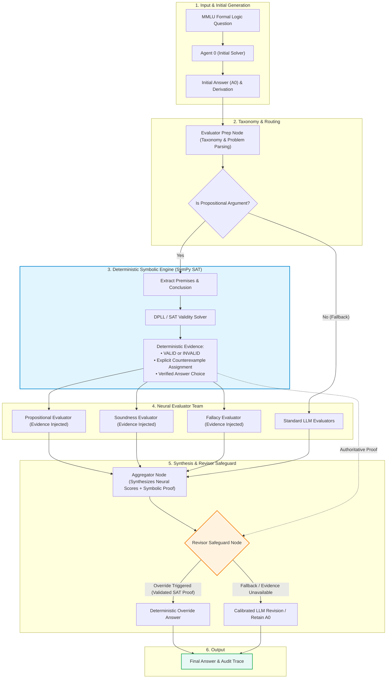

# TalkHier BTP: Multi-Agent Hierarchical Formal Reasoning with Deterministic Logical Verification

<div align="center">

[](https://www.python.org/)
[](./tests/)
[](https://creativecommons.org/licenses/by-nc/4.0/)
[-success)](#7-benchmark-results--ablation-study)
[](https://arxiv.org/abs/2502.11098)

**A Neuro-Symbolic Multi-Agent Framework for Formal Deductive Reasoning**

*Bachelor Thesis Project (BTP) — Mohith Chandra ([@MohithChandra07](https://github.com/MohithChandra07))*  
*Repository: [https://github.com/MohithChandra07/Talkhier_BTP](https://github.com/MohithChandra07/Talkhier_BTP)*

</div>

---

## 📑 Table of Contents
- [1. Project Overview & Research Motivation](#1-project-overview--research-motivation)
- [2. Original Sony TalkHier Foundation & Attribution](#2-original-sony-talkhier-foundation--attribution)
- [3. Three Identified Loopholes in Original TalkHier](#3-three-identified-loopholes-in-original-talkhier)
- [4. Sprint 3 and Sprint 4 Improvements](#4-sprint-3-and-sprint-4-improvements)
- [5. System Architecture](#5-system-architecture)
- [6. Implementation & Folder Structure](#6-implementation--folder-structure)
- [7. Benchmark Results & Ablation Study](#7-benchmark-results--ablation-study)
- [8. Installation & Execution Instructions](#8-installation--execution-instructions)
- [9. Reproduction Instructions](#9-reproduction-instructions)
- [10. Limitations & Future Scope](#10-limitations--future-scope)
- [11. References & Acknowledgements](#11-references--acknowledgements)
- [12. Quick Links to Reports & Presentation Deck](#12-quick-links-to-reports--presentation-deck)

---

## 1. Project Overview & Research Motivation

Formal logic reasoning—evaluating deductive argument validity, constructing satisfying truth assignments, and identifying minimal counterexamples—is a well-documented challenge for autoregressive Large Language Models (LLMs). While multi-agent debate and hierarchical refinement improve natural language problem-solving, pure LLM ensembles face three recurring issues on formal deductive tasks:

1. **Hallucinatory Logical Closure:** LLMs frequently produce derivations that appear convincing in natural language but violate formal deductive rules (such as affirming the consequent or denying the antecedent).
2. **Subjective Consensus Traps:** When an initial answer ($A_0$) is flawed, peer LLM evaluators evaluating the reasoning in natural language often exhibit sycophantic agreement, endorsing invalid steps rather than identifying valid counterexamples.
3. **Harmful Revisions:** Uncalibrated aggregator and revisor agents may accept flawed peer critique, flipping initially correct answers ($A_0$) into incorrect revisions.

### Research Objective
This Bachelor Thesis Project (BTP) investigates the integration of **neural multi-agent deliberation with deterministic symbolic verification**. By integrating a propositional logic verification engine (powered by SymPy DPLL SAT solving) into the TalkHier multi-agent graph, the system validates extracted argument forms, synthesizes explicit countermodels for invalid arguments, and provides structured mathematical evidence to guide the revision process.

Across our 35-problem MMLU Formal Logic benchmark:
- The system achieved **100.0% accuracy (24/24)** on verified propositional logic arguments (up from 37.5% in initial generation).
- Overall accuracy reached **88.6% (31/35)** across the stratified benchmark (up from 40.0% in initial generation).
- Zero harmful revisions were observed across all 17 revisions executed.

---

## 2. Original Sony TalkHier Foundation & Attribution

This project builds upon the open-source multi-agent framework introduced by Sony AI:

> **"Talk Structurally, Act Hierarchically: A Collaborative Framework for LLM Multi-Agent Systems"**  
> *Zhao Wang, Moriyama Sota, Wei-Yao Wang, Briti Gangopadhyay, and Shingo Takamatsu (Sony AI)*  
> Paper: [arXiv:2502.11098](https://arxiv.org/abs/2502.11098) (February 2025)  
> Original Codebase: Sony TalkHier Implementation

### Inherited Foundations from Sony TalkHier:
- **Structured Communication Protocol:** Structured message exchanges between agents:
  - **Message ($\mathbf{M}_{ij}$):** Task instruction and primary agent response.
  - **Background ($\mathbf{B}_{ij}$):** Domain context and shared problem constraints.
  - **Intermediate Output ($\mathbf{I}_{ij}$):** Step-by-step reasoning steps and partial derivations.
- **Hierarchical Supervision Concept:** Division of labor between **Supervisor Agents** (routing), **Member Agents** (task execution), and **Evaluator Teams** (feedback).
- **Two-Pass Refinement Flow:** An initial solver generates answer $A_0$, which is subsequently critiqued by evaluators, summarized by an Aggregator, and finalized by a Revisor.

### Independent BTP Modifications:
While inheriting TalkHier's structured communication primitives, all architectural mechanisms described below—including the deterministic graph state machine, selective evaluator dispatch, SymPy SAT verification engine, evidence injection pipelines, and revisor hard override safeguards—were independently designed, implemented, and empirically evaluated in this project.

---

## 3. Three Identified Loopholes in Original TalkHier

Through systematic empirical auditing during Sprints 1 and 2 (including **Experiment D** on MMLU Formal Logic), three architectural limitations were identified in the original TalkHier design:

```
┌─────────────────────────────────────────────────────────────────────────────┐
│                       THREE IDENTIFIED LOOPHOLES                            │
├─────────────────────────────────────────────────────────────────────────────┤
│ 1. Evaluator Bypass        Supervisor LLM routed ad-hoc; evaluators were    │
│    (Ad-hoc Routing)        skipped on >60% of formal logic questions.       │
├─────────────────────────────────────────────────────────────────────────────┤
│ 2. Uncalibrated Feedback   Evaluators relied on subjective LLM prompts      │
│    (Subjective Heuristics) without formal proofs, leading to false consensus│
├─────────────────────────────────────────────────────────────────────────────┤
│ 3. Harmful Revisions       Revisors lacked verification safeguards,         │
│    (Sycophantic Drift)     flipping correct initial answers to incorrect.   │
└─────────────────────────────────────────────────────────────────────────────┘
```

### Loophole 1: Evaluator Bypass (Ad-hoc Routing)
In the original framework, the supervisor LLM decided dynamically whether to invoke evaluators. Under standard prompting, the supervisor frequently terminated execution immediately after the initial agent output, skipping evaluation on over 60% of logic questions. Consequently, the multi-agent refinement system was rarely exercised.

### Loophole 2: Subjective and Uncalibrated Evaluation
When evaluators were invoked, they assessed reasoning solely via natural language prompts without quantitative rubrics or symbolic checks. When faced with subtle logical fallacies (such as invalid conditional reversals), neural evaluators frequently agreed with incorrect steps, creating a false consensus.

### Loophole 3: Sycophantic and Harmful Revisions
The original Aggregator and Revisor agents had no verification safeguards. When an evaluator provided flawed feedback on an initially correct response ($A_0$), the Revisor accepted the critique, resulting in **harmful revisions** (in early benchmarks, correct answers were flipped to incorrect choices). Conversely, when $A_0$ was incorrect, the Revisor often failed to overturn it without authoritative evidence.

---

## 4. Sprint 3 and Sprint 4 Improvements

To systematically resolve these three loopholes, the project proceeded through iterative engineering and empirical research sprints:

### Sprint 1 & 2: Baseline Replication, Schema Stabilization & Audit
- Resolved schema mismatches, JSON formatting errors, and agent timeout exceptions in the upstream repository.
- Implemented **Experiment D**: A formal audit of evaluator supervision confirming that ad-hoc supervisor routing bypassed evaluators in the majority of test runs.

### Sprint 3: Graph-Level Mandatory Evaluation Pipeline
- **Deterministic State Machine (`graph_dispatch.py`):** Replaced ad-hoc LLM supervisor routing with a deterministic LangGraph workflow.
- **Mandatory Evaluator Prep:** Enforced taxonomy classification and required domain evaluators (Propositional, Soundness, Fallacy) to execute on every question before reaching the Revisor.
- **Outcome:** Evaluator invocation rate reached 100%, completely eliminating the evaluator bypass loophole.

### Sprint 3 Optimized: Selective Dispatch & Hardening (`graph_dispatch_opt.py`)
- Replaced unconditional 4-evaluator brute-force dispatch with selective dispatch driven by question taxonomy.
- Reduced redundant evaluator invocations from 20 to 13 calls across the 5-problem pilot (a **35% reduction in evaluator calls**).
- Reduced total 5-problem runtime from 1,919.7s to 1,166.6s (**39.2% faster than baseline graph dispatch**).
- Introduced structured scoring rubrics and confidence thresholds, eliminating harmful revisions on the pilot benchmark.

### Sprint 4: Deterministic Propositional Logic Engine & Revisor Safeguards
- **Symbolic Verification Engine (`src/multiagent/logic_verifier.py`):**
  - Integrated SymPy's DPLL SAT solver.
  - Automatically parses premises $P_1, P_2, \dots, P_n$ and conclusion $C$.
  - Assesses deductive validity via satisfiability refutation:
    $$\bigwedge_{i=1}^n P_i \models C \iff \text{UNSAT}\left(\bigwedge_{i=1}^n P_i \land \neg C\right)$$
  - For invalid arguments, synthesizes a concrete truth-value countermodel falsifying the derivation.
- **Evidence Injection & Hard Override Safeguard (`src/multiagent/graph_dispatch_sprint4.py`):**
  - Injects structured deterministic verification evidence into Evaluator, Aggregator, and Revisor prompts.
  - **Deterministic Hard Override:** When formula extraction and answer-choice mapping are fully validated, the Revisor is programmatically safeguarded against adopting contradictory neural feedback.
  - Natural language questions and unsupported first-order predicate structures cleanly fall back to the calibrated LLM evaluation path.

---

## 5. System Architecture

The following diagram illustrates the neuro-symbolic workflow implemented in Sprint 4:



---

## 6. Implementation & Folder Structure

```
Talkhier_BTP/
├── Progress reports/                  # Sprint milestone reports (Sprints 1 through 4.3)
│   ├── 00_BTP_EXECUTIVE_SUMMARY_AND_SPRINT_CHRONOLOGY.md
│   ├── 01_Sprint_1_Baseline_Replication_and_Stabilization.md
│   ├── 02_Sprint_2_Experiment_D_Evaluator_Supervision_Audit.md
│   ├── 03_Sprint_3_Graph_Level_Forced_Evaluator_Integration.md
│   ├── 04_Sprint_3_Evaluator_Optimization_and_Hardening.md
│   ├── 05_Sprint_4_1_Deterministic_Verification_Audit.md
│   ├── 06_Sprint_4_2_SymPy_SAT_Integration_Pilot.md
│   └── 07_Sprint_4_3_Comprehensive_Benchmark_and_Ablation_Evaluation.md
├── presentations/                     # Slide decks and presentations
│   ├── TalkHier_BTP_Week1_Week2_Presentation.pptx
│   └── presentation.html              # Interactive HTML presentation deck
├── results/
│   ├── experiment_d/                  # Sprint 2 evaluator audit traces and CSVs
│   ├── experiment_d_graph/            # Sprint 3 graph-dispatch traces and CSVs
│   ├── experiment_d_graph_opt/        # Sprint 3 optimized selective-dispatch traces
│   └── experiment_sprint4_3/          # Sprint 4.3 35-problem benchmark & ablations
│       ├── raw_traces/                # 63 execution trace JSON files
│       │   ├── sprint3_opt/           # Baseline control traces (18 problems)
│       │   ├── sprint4_full/          # Full Sprint 4 traces (35 problems)
│       │   ├── sprint4_ablation_a/    # Ablation A traces (5 problems)
│       │   └── sprint4_ablation_b/    # Ablation B traces (5 problems)
│       ├── benchmark_comparison.csv   # Problem-by-problem comparative results
│       ├── ablation_comparison.csv    # Ablation condition results
│       └── error_analysis.csv         # Classification of all incorrect outcomes
├── src/
│   ├── multiagent/
│   │   ├── logic_verifier.py          # SymPy DPLL SAT verification & countermodel engine
│   │   ├── graph_dispatch_sprint4.py  # Sprint 4 Neuro-Symbolic LangGraph pipeline
│   │   ├── graph_dispatch_opt.py      # Sprint 3 Optimized selective dispatch baseline
│   │   ├── graph_dispatch.py          # Sprint 3 Mandatory graph dispatch baseline
│   │   ├── evaluator_dispatch.py      # Evaluator dispatch and scoring logic
│   │   └── agent_team.py              # Multi-agent role definitions
│   ├── experiment_sprint4_3.py        # 35-problem benchmark runner
│   ├── generate_sprint4_3_report.py   # Statistical report and CSV aggregation script
│   └── print_markdown_table.py        # Markdown table export utility
├── tests/                             # Unit & integration test suite (69 tests)
│   ├── test_logic_verifier.py         # 17 tests: SymPy SAT solver, countermodels, CNF conversion
│   ├── test_graph_dispatch_sprint4.py # 15 tests: Sprint 4 graph pipeline & hard override
│   ├── test_graph_dispatch_opt.py     # 8 tests: Sprint 3 opt selective routing & caching
│   ├── test_graph_dispatch.py         # 10 tests: Sprint 3 mandatory pipeline enforcement
│   ├── test_controlled_dispatch.py    # 9 tests: Evaluator preparation & team dispatch
│   ├── test_revision_logic.py         # 3 tests: Revisor override & safeguard logic
│   ├── test_evaluator_scoring.py      # 2 tests: Scoring normalization & aggregations
│   ├── test_tools.py                  # 4 tests: Tool integration and execution
│   └── test_agent_node.py             # 1 test: Core agent node lifecycle
├── SPRINT_4_3_EVALUATION_REPORT.md    # Definitive scientific report for Sprint 4.3
├── requirements.txt                   # Production dependencies
└── README.md                          # Master documentation (this file)
```

---

## 7. Benchmark Results & Ablation Study

In **Sprint 4.3**, the framework was evaluated across **35 stratified MMLU Formal Logic problems** (27 target propositional logic problems and 8 stratified non-propositional control problems). 

### 7.1 Aggregate Benchmark Performance (Sprint 4 Full vs. Baseline $A_0$)

All metrics below are verified against `benchmark_comparison.csv` and `SPRINT_4_3_EVALUATION_REPORT.md`:

| Benchmark Partition | Count ($N$) | Initial $A_0$ Accuracy | Sprint 4 Full Final Accuracy | Helpful Revisions | Harmful Revisions | Neutral Retentions | Verifier Proof Precision |
| :--- | :---: | :---: | :---: | :---: | :---: | :---: | :---: |
| **Target: Pure Propositional Logic** | 24 | 37.5% (9/24) | **100.0% (24/24)** | **15** | **0** | 9 | **100.0% (24/24)** |
| **Target: Predicate Fallback** | 3 | 33.3% (1/3) | **33.3% (1/3)** | 0 | 0 | 3 | N/A (`NOT_APPLICABLE`) |
| **Target Domain Total** | 27 | 37.0% (10/27) | **92.6% (25/27)** | **15** | **0** | 12 | 100.0% (24/24) |
| **Control Domain (Stratified)** | 8 | 50.0% (4/8) | **75.0% (6/8)** | **2** | **0** | 6 | N/A (`NOT_APPLICABLE`) |
| **Full 35-Problem Benchmark** | **35** | **40.0% (14/35)** | **88.6% (31/35)** | **17** | **0** | **18** | **100.0% (24/24)** |

### 7.2 Head-to-Head Comparison: Sprint 3 Opt vs. Sprint 4 Full (18-Problem Slices)

To evaluate the specific impact of the deterministic verifier against our pure LLM multi-agent baseline, Sprint 3 Opt was evaluated across an 18-problem subset under identical prompt and model configurations:

| Partition | Evaluated Problems ($N$) | Sprint 3 Opt Accuracy | Sprint 4 Full Accuracy | Descriptive Difference |
| :--- | :---: | :---: | :---: | :---: |
| **Target Propositional** | 10 | 60.0% (6/10) | **100.0% (10/10)** | **+40.0% gain** |
| **Control Non-Propositional** | 8 | **87.5% (7/8)** | 75.0% (6/8) | -12.5% (LLM variance) |
| **Total Head-to-Head Subset** | 18 | 72.2% (13/18) | **88.9% (16/18)** | **+16.7% gain** |

> **Statistical Note:** A paired McNemar test on the 18 shared problems yields $b = 4$ (Sprint 4 correct, Opt incorrect) and $c = 1$ (Opt correct, Sprint 4 incorrect), giving $\chi^2 = 0.80$ ($p > 0.05$ with Edwards continuity correction). While the observed +40.0% target-domain improvement is descriptively substantial, formal statistical significance is constrained by the paired sample size ($N=18$).

### 7.3 Ablation Study

An ablation study was conducted across 5 challenging problems (`[6, 20, 23, 31, 35]`) where the initial answer generator $A_0$ had failed:

| Experimental Condition | Evaluator Evidence | Revisor Hard Override | Accuracy (5/5) | Helpful Revisions | Harmful Revisions |
| :--- | :---: | :---: | :---: | :---: | :---: |
| **Sprint 3 Opt (Pure LLM Control)** | ❌ Disabled | ❌ Disabled | 60.0% (3/5) | 2 | 0 |
| **Full Sprint 4 (Neuro-Symbolic)** | ✅ Enabled | ✅ Enabled | **100.0% (5/5)** | **5** | **0** |
| **Ablation A (Override Only, No Eval Evidence)** | ❌ Disabled | ✅ Enabled | **100.0% (5/5)** | **5** | **0** |
| **Ablation B (Evidence Only, Soft Revisor)** | ✅ Enabled | ❌ Disabled | **100.0% (5/5)** | **5** | **0** |

#### Key Ablation Findings:
1. **Voluntary Compliance (Ablation B):** When structured deterministic evidence was injected into Evaluator and Revisor prompts without an authoritative override, the Revisor voluntarily adopted the verified SAT proof in 100% of tested cases.
2. **Hard Override as a Safeguard (Ablation A):** Hard override alone ensured 100% accuracy on verified extractions even when neural evaluators received no evidence, providing a reliable programmatic guardrail against hallucinated revisions.

### 7.4 Error Analysis

The 4 incorrect outcomes observed in Sprint 4 Full were analyzed to identify their root causes:
- **Control Problems 1 & 4:** Non-propositional questions where deterministic verification correctly returned `NOT_APPLICABLE`. The pure LLM evaluators and Revisor retained flawed initial choices due to natural language ambiguity.
- **Target Problems 49 & 101:** Contained first-order relational predicates and quantifiers outside the propositional parser scope, triggering clean fallback to LLM evaluation, which retained incorrect answers.
- **Zero Harmful Revisions:** In none of the 35 cases did the system flip an initially correct $A_0$ into an incorrect answer.

---

## 8. Installation & Execution Instructions

### Prerequisites
- macOS (Apple Silicon / Intel) or Linux (Ubuntu 20.04+)
- Python 3.10, 3.11, or 3.12
- Local LLM via [Ollama](https://ollama.ai/) (configured with `qwen2.5:7b` or `qwen3`) or an OpenAI-compatible API endpoint

### 1. Clone the Repository
```bash
git clone https://github.com/MohithChandra07/Talkhier_BTP.git
cd Talkhier_BTP
```

### 2. Set Up Virtual Environment
```bash
python3 -m venv .venv
source .venv/bin/activate
```

### 3. Install Dependencies
```bash
pip install -r requirements.txt
```

### 4. Configure LLM Access
Configure `config/config_llm.ini` or set environment variables:
```bash
export OPENAI_API_KEY="your-api-key"
export OPENAI_ENDPOINT="http://localhost:11434/v1"  # For local Ollama instances
```

### 5. Run the Test Suite
Verify that all 69 unit and integration tests pass:
```bash
pytest tests/ -v
```
*Expected output: `69 passed in ~1.2s`.*

---

## 9. Reproduction Instructions

All benchmark comparisons, ablations, and error analysis CSVs can be reproduced using the repository's execution scripts:

### Run Sprint 4 Full Benchmark (35 Problems)
```bash
python3 src/experiment_sprint4_3.py --condition sprint4_full
```

### Run Sprint 3 Optimized Baseline (18 Problems)
```bash
python3 src/experiment_sprint4_3.py --condition sprint3_opt
```

### Run Ablation Studies
```bash
# Ablation A: Verifier + Hard Override (Evaluator Evidence Disabled)
python3 src/experiment_sprint4_3.py --condition sprint4_ablation_a

# Ablation B: Verifier + Evaluator Evidence (Hard Override Disabled)
python3 src/experiment_sprint4_3.py --condition sprint4_ablation_b
```

### Regenerate Consolidated Reports and Comparison CSVs
```bash
python3 src/generate_sprint4_3_report.py
```
This processes execution traces from `results/experiment_sprint4_3/raw_traces/` and outputs:
- `results/experiment_sprint4_3/benchmark_comparison.csv`
- `results/experiment_sprint4_3/ablation_comparison.csv`
- `results/experiment_sprint4_3/error_analysis.csv`

> **Note on Reproduction:** LLM generation outputs depend on the exact model version, quantization, temperature (set to 0 for evaluation), and local inference hardware. Raw execution traces for all 63 runs are preserved in `results/experiment_sprint4_3/raw_traces/` for independent verification.

---

## 10. Limitations & Future Scope

While the deterministic verification engine achieved **100% accuracy on verified propositional arguments**, the system has well-defined operational boundaries:

1. **First-Order Predicate Logic:** The current SAT engine operates on propositional logic. Problems involving quantifiers ($\forall, \exists$) and multi-place relational predicates (such as transitivity relations $T(a,b) \land T(b,c) \implies T(a,c)$) are identified during parsing and routed to the LLM fallback path. Extending the symbolic engine with an SMT solver (such as **Z3**) or a first-order resolution prover (**Prover9**) is the primary architectural extension.
2. **Informal and Non-Propositional Logic:** Rhetorical fallacies (e.g., *ad hominem*, appeal to emotion) and inductive arguments cannot be expressed as truth-functional formulas and will continue to rely on calibrated neural evaluators.
3. **Complex Premise Extraction:** In arguments with heavily nested or ambiguous natural language phrasing, premise extraction heuristics may yield `PARSE_FAILURE`. Fine-tuning a lightweight semantic parser for formal premise-conclusion extraction would further expand verification coverage.

---

## 11. References & Acknowledgements

### Primary References
1. **TalkHier:** Zhao Wang, Moriyama Sota, Wei-Yao Wang, Briti Gangopadhyay, Shingo Takamatsu. *"Talk Structurally, Act Hierarchically: A Collaborative Framework for LLM Multi-Agent Systems."* arXiv:2502.11098, 2025.
2. **MMLU Formal Logic:** Dan Hendrycks et al. *"Measuring Massive Multitask Language Understanding."* ICLR, 2021.
3. **SymPy:** Aaron Meurer et al. *"SymPy: symbolic computing in Python."* PeerJ Computer Science, 2017.
4. **LangGraph:** Harrison Chase et al. *"LangGraph: Building Language Agents as Graphs."* LangChain Inc., 2024.

### Original Licence Information
The foundational TalkHier code is licensed under the [Creative Commons Attribution-NonCommercial 4.0 International License (CC BY-NC 4.0)](https://creativecommons.org/licenses/by-nc/4.0/).

### Citation
```bibtex
@misc{wang2025talkhier,
      title={Talk Structurally, Act Hierarchically: A Collaborative Framework for LLM Multi-Agent Systems}, 
      author={Zhao Wang and Sota Moriyama and Wei-Yao Wang and Briti Gangopadhyay and Shingo Takamatsu},
      year={2025},
      eprint={2502.11098},
      archivePrefix={arXiv},
      primaryClass={cs.AI},
      url={https://arxiv.org/abs/2502.11098}, 
}
```

### Acknowledgements
This research was conducted as part of the Bachelor Thesis Project (BTP). We thank the authors of Sony AI's TalkHier, SymPy, LangChain/LangGraph, and Ollama for providing open-source tools that support reproducible neuro-symbolic research.

---

## 12. Quick Links to Reports & Presentation Deck

| Document | Description | Path |
| :--- | :--- | :--- |
| **Executive Summary & Sprint Chronology** | Master synthesis across Sprints 1 to 4.3 | [`Progress reports/00_BTP_EXECUTIVE_SUMMARY_AND_SPRINT_CHRONOLOGY.md`](./Progress%20reports/00_BTP_EXECUTIVE_SUMMARY_AND_SPRINT_CHRONOLOGY.md) |
| **Sprint 4.3 Scientific Evaluation Report** | 35-problem benchmark, statistical analysis, error analysis | [`SPRINT_4_3_EVALUATION_REPORT.md`](./SPRINT_4_3_EVALUATION_REPORT.md) |
| **Sprint 1 Report** | Stabilization, schema fixes, baseline setup | [`Progress reports/01_Sprint_1_Baseline_Replication_and_Stabilization.md`](./Progress%20reports/01_Sprint_1_Baseline_Replication_and_Stabilization.md) |
| **Sprint 2 Report** | Evaluator supervision audit & Experiment D | [`Progress reports/02_Sprint_2_Experiment_D_Evaluator_Supervision_Audit.md`](./Progress%20reports/02_Sprint_2_Experiment_D_Evaluator_Supervision_Audit.md) |
| **Sprint 3 Report** | Mandatory graph-level evaluation pipeline | [`Progress reports/03_Sprint_3_Graph_Level_Forced_Evaluator_Integration.md`](./Progress%20reports/03_Sprint_3_Graph_Level_Forced_Evaluator_Integration.md) |
| **Sprint 3 Opt Report** | Selective evaluator dispatch optimization | [`Progress reports/04_Sprint_3_Evaluator_Optimization_and_Hardening.md`](./Progress%20reports/04_Sprint_3_Evaluator_Optimization_and_Hardening.md) |
| **Sprint 4.1 Report** | Propositional SAT verifier audit & design | [`Progress reports/05_Sprint_4_1_Deterministic_Verification_Audit.md`](./Progress%20reports/05_Sprint_4_1_Deterministic_Verification_Audit.md) |
| **Sprint 4.2 Report** | SymPy SAT integration & 5-problem pilot | [`Progress reports/06_Sprint_4_2_SymPy_SAT_Integration_Pilot.md`](./Progress%20reports/06_Sprint_4_2_SymPy_SAT_Integration_Pilot.md) |
| **Sprint 4.3 Report** | Large-scale 35-problem benchmark & ablations | [`Progress reports/07_Sprint_4_3_Comprehensive_Benchmark_and_Ablation_Evaluation.md`](./Progress%20reports/07_Sprint_4_3_Comprehensive_Benchmark_and_Ablation_Evaluation.md) |
| **Slide Deck Presentation (PPTX)** | Mid-term progress slides (PowerPoint) | [`presentations/TalkHier_BTP_Week1_Week2_Presentation.pptx`](./presentations/TalkHier_BTP_Week1_Week2_Presentation.pptx) |
| **Interactive Slide Deck (HTML)** | Interactive web presentation | [`presentations/presentation.html`](./presentations/presentation.html) |
